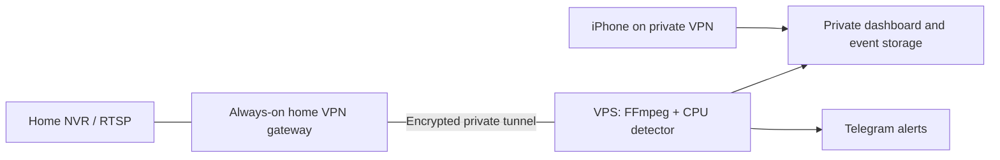

# Future VPS deployment

This is an optional deployment path prepared in the repository. The active
installation remains on the home Mac. No VPS, VPN, account, paid service, cloud
storage or public endpoint has been created. The Linux container has not yet
been built or run on a VPS. Validate that environment before migrating.

## Architecture



The NVR stays at home and keeps recording. A VPS cannot normally reach a home
192.168.x.x address over the internet. It needs a private route through a device
that stays on at home: a capable router, small server, or another VPN gateway.
The Mac is not required as the detection server after migration, but some home
VPN gateway must remain available. If it runs on the Mac, that Mac still needs
to stay on.

WireGuard site-to-site routing or a Tailscale subnet router are suitable patterns.
Restrict the route and VPN access rules to the NVR and intended users/ports.
Do not expose the NVR HTTP, RTSP or admin ports through router forwarding. The
provided dashboard port is bound only to a private VPN IP; it is not a public
website. The private tunnel encrypts transport; this sample serves HTTP inside
that tunnel. Public HTTPS hosting is a separate deployment design.

Primary references: [Tailscale subnet routing](https://tailscale.com/docs/use-cases/personal-or-at-home-use/access-devices-without-tailscale),
[Docker port binding](https://docs.docker.com/get-started/docker-concepts/running-containers/publishing-ports/),
[Ultralytics prediction devices](https://docs.ultralytics.com/modes/predict).

## Runtime differences

| Component | Current Mac | Future Linux VPS baseline |
| --- | --- | --- |
| Detector | YOLO11 nano / Core ML | Same weights, PyTorch CPU |
| Model file | yolo11n.mlpackage | yolo11n.pt |
| Video decoder | VideoToolbox, software fallback | FFmpeg software |
| Services | macOS LaunchAgents + Node gateway | Docker Compose app + watchdog |
| Data | Application Support/Watchyard | Persistent /data bind mount |
| Access | Home Wi-Fi; local Mac bypass | VPN allowlist; login required even on localhost |

Core ML models cannot be used on Linux. CPU is the portable baseline, not a
promise that a low-end VPS will keep up. GPU/OpenVINO/other accelerators need
separate runtime packaging and measurement. Benchmark the four actual streams
before choosing hardware. The initial Docker recipe targets Linux x86-64; verify
CPU wheels and codec support separately for other architectures.

A remote detector continuously receives the selected streams. Four 512 kbit/s
streams would total about 2 Mbit/s, approximately 22 GB/day or 664 GB per 30 days
before transport overhead, if that rate were sustained. Actual variable bitrate
can differ. Check home upload capacity, metered data, VPS transfer/storage costs
and retention before committing to a provider. No hardware or provider purchase
is needed now.

## Configuration

`WATCHYARD_DEPLOYMENT` defaults to `local`, preserving current Mac behaviour.
The `vps` profile refuses missing host/CIDR allowlists, unrestricted /0 networks,
localhost authentication bypass and wildcard trusted proxies.

| Variable | Use |
| --- | --- |
| WATCHYARD_DATA | Persistent data directory |
| WATCHYARD_MODEL_BACKEND | auto, coreml or pytorch; auto chooses the native platform |
| WATCHYARD_MODEL_DEVICE | cpu by default for PyTorch |
| WATCHYARD_MODEL_PATH | Optional existing model path; relative paths use data/models |
| WATCHYARD_DECODER | auto, videotoolbox or software |
| WATCHYARD_HOST / PORT | Application bind address/port |
| WATCHYARD_ALLOWED_HOSTS | Exact comma-separated Host names/IPs |
| WATCHYARD_ALLOWED_CIDRS | Comma-separated private VPN/client networks |
| WATCHYARD_LOCAL_BYPASS | Must be 0 in the VPS profile |
| WATCHYARD_PROXY_HEADERS | 0 for the direct private service |
| WATCHYARD_TRUSTED_PROXIES | Exact trusted sources if a reverse proxy is later added |
| WATCHYARD_BIND_IP | Compose host publication address: the VPS private VPN IP |

Keep proxy headers disabled for the sample. If adding a TLS proxy later,
configure exact proxy trust, correct external Host/scheme, and test Origin checks
and secure cookies; do not trust arbitrary forwarding headers. Login cookies
are HttpOnly and SameSite; HTTPS requests receive Secure cookies.

## Future setup steps — run on the VPS, not the current Mac

1. Provision Linux and Docker Compose, establish the VPN route, and verify the
   NVR is reachable privately. Limit dashboard access to your VPN clients.
2. Clone the repository. From `deploy/vps`, copy `runtime.env.example` to
   `runtime.env`. Replace the example VPN address, exact Host values and client
   CIDRs. The example address is not a live server. Never set BIND_IP to 0.0.0.0.
3. Create the data directory owned by the container UID, with private permissions:

   ```sh
   sudo install -d -o 10001 -g 10001 -m 700 data
   docker compose --env-file runtime.env -f compose.yaml build
   ```

4. For a new installation, configure secrets interactively and prepare the model:

   ```sh
   docker compose --env-file runtime.env -f compose.yaml run --rm --no-deps watchyard python scripts/configure.py
   docker compose --env-file runtime.env -f compose.yaml run --rm --no-deps watchyard python scripts/dashboard_code.py
   docker compose --env-file runtime.env -f compose.yaml run --rm --no-deps watchyard python scripts/prepare_model.py
   ```

   These one-off commands do not publish service ports. Save the generated
   dashboard code privately. NVR and Telegram secrets live in data/secrets.json,
   not the environment example or Git. Model preparation downloads official
   weights; the running service requires the model to exist and does not fetch
   it automatically during detection.

5. Check the resolved configuration and start the two services:

   ```sh
   docker compose --env-file runtime.env -f compose.yaml config --quiet
   docker compose --env-file runtime.env -f compose.yaml up -d
   docker compose --env-file runtime.env -f compose.yaml ps
   ```

6. Connect the iPhone to the same private VPN, open
   `http://<VPS-private-VPN-IP>:8765`, sign in, and test snapshots, detection,
   Telegram and outage recovery. Keep the public port closed at the provider
   firewall. Observe CPU, memory, stream freshness and transfer usage under load.

For upgrades, stop both containers, back up data, rebuild, and recreate both;
the watchdog shares the app's network namespace. SQLite and images are on the
persistent mount. The watchdog can detect an app failure while this VPS runs,
not the loss of its own host. A separate external heartbeat remains necessary
for complete host-outage reporting.

## Migration from the Mac

- Prepare the VPN and CPU model before stopping the Mac installation.
- Back up event history, event JPEGs and settings. Stop all Mac services with
  `sh scripts/service.sh stop` for a consistent final copy. Copy the data securely
  (for SQLite, stop writers or use SQLite backup; do not copy a live database
  without its WAL). Exclude runtime, logs and macOS model packages.
- Copy the protected secrets only if preserving the existing Telegram pairing.
  Rotate the dashboard code/session key on the VPS. Keep the already paired
  Telegram chat ID and token if retaining the same bot.
- Run only ONE detector/poller with that Telegram bot token. Running both hosts
  concurrently causes duplicate alerts and getUpdates conflicts. Start the VPS
  only after the Mac poller stops.
- Validate actual detection quality and CPU throughput. CPU execution can differ
  from Core ML; existing confidence settings are a starting point, not validation.
- Rollback: stop VPS app and watchdog, then start the Mac services. Preserve
  backups; do not overwrite histories in both directions blindly.

## Validation status

Platform selection, fail-closed VPS settings, network authentication and
readiness monitoring have automated tests. Compose configuration is validated
locally without starting containers. The CPU backend has completed warm-up
inference on the development Mac. This is not a Linux container or VPS benchmark;
building the image, validating VPN routing and a real Linux pilot remain required.
